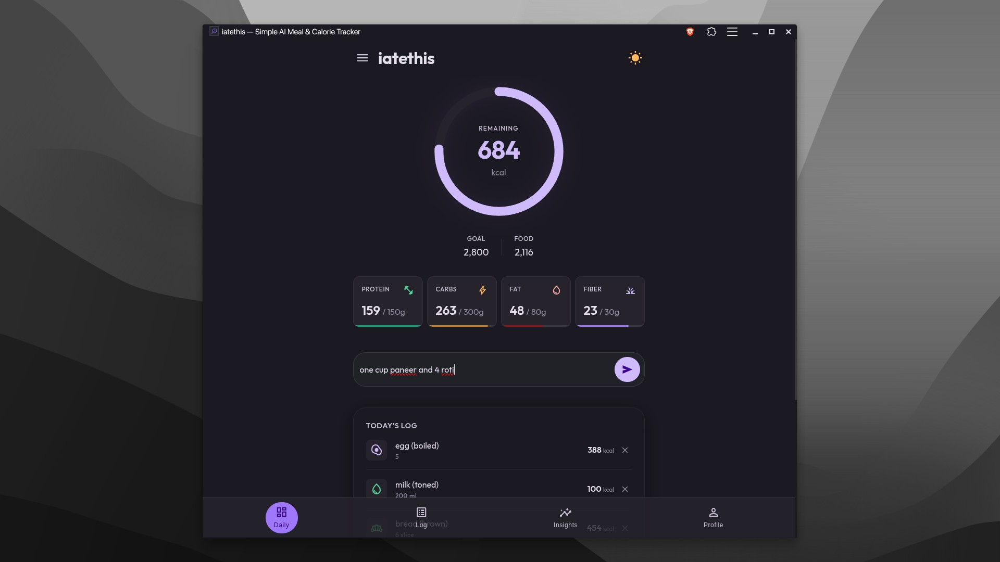

# iatethis

A fast, local-first meal and calorie tracker. You just type what you ate in plain English, and it logs your macros.

Live app: [iatethis.today](https://iatethis.today)



---

## Why

Most calorie counters are bloated. They demand 10 taps to log an apple, push $80/year subscriptions, bombard you with ads, and spin on network requests just to look up a cup of tea.

`iatethis` was built with three rules:
1. **Typing is faster than searching:** Type `"2 rotis with dal tadka and 1 egg"`. The natural-language parser handles quantities, units, and foods in one pass.
2. **Local-first speed:** If you've logged a food before, or if it's in the offline seed library, it resolves in your browser in under 10ms. No waiting on API roundtrips.
3. **Your data stays with you:** Everything is stored locally in your browser's IndexedDB. No forced accounts, no marketing emails, no trackers.

---

## How It Works

```
"2 rotis with dal and 1 egg"
           │
           ▼
┌─────────────────────────┐
│ Local Matcher (IndexedDB)│ ─── Found (95% of meals) ───► Instant Log (<10ms)
└─────────────────────────┘
           │
      Unrecognized
           ▼
┌─────────────────────────┐
│ Cloudflare Workers AI   │ ─── Resolves per 100g macros once ───► Cached locally forever
└─────────────────────────┘
```

1. **Local Dictionary First:** An embedded dictionary of staples (with comprehensive Indian food compositions like rotis, dals, sabzis, paneer, and eggs) and your personal meal history live inside client-side IndexedDB.
2. **On-Edge AI Resolution:** When you log an unfamiliar item, Cloudflare Workers AI (`@cf/meta/llama-3.1-8b-instruct-fp8`) infers the nutritional data per 100g. Once fetched, it is permanently saved to your device and never queried again.
3. **Contextual Daily Briefing:** Instead of generic bot banter or robotic arithmetic (*"You are 450 calories short"*), an on-device briefing evaluates food quality, checks macro pacing, and adapts to the time of day (morning kickoff, mid-day pacing, or bedtime debrief).

---

## Tech Stack

- **Framework:** [SvelteKit](https://kit.svelte.dev/) with Svelte 5 runes (`$state`, `$derived`)
- **Runtime & AI:** [Cloudflare Workers](https://workers.cloudflare.com/) + native [Workers AI](https://developers.cloudflare.com/workers-ai/) (`@cf/meta/llama-3.1-8b-instruct-fp8`)
- **Storage:** Client-side [IndexedDB](https://developer.mozilla.org/en-US/docs/Web/API/IndexedDB_API) via `idb`
- **Fallback:** Google Gemini 2.5 Flash API (optional secondary fallback)
- **Offline / PWA:** Service worker caching for 100% offline logging once loaded

---

## Development

### Prerequisites
- Node.js 18+
- Cloudflare Wrangler CLI

### Setup

```bash
git clone https://github.com/your-username/iatethis.git
cd iatethis
npm install
```

### Run Locally

To run with Cloudflare Workers AI bindings locally:

```bash
npm run build
npx wrangler dev --port 8787
```

Open `http://localhost:8787`.

### Run Tests

```bash
npm test
```

---

## License

MIT
